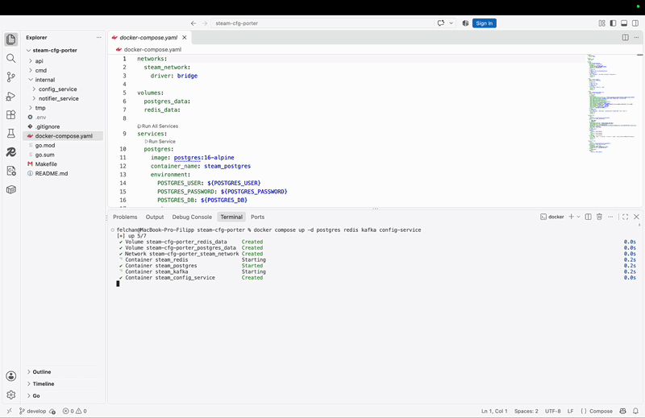
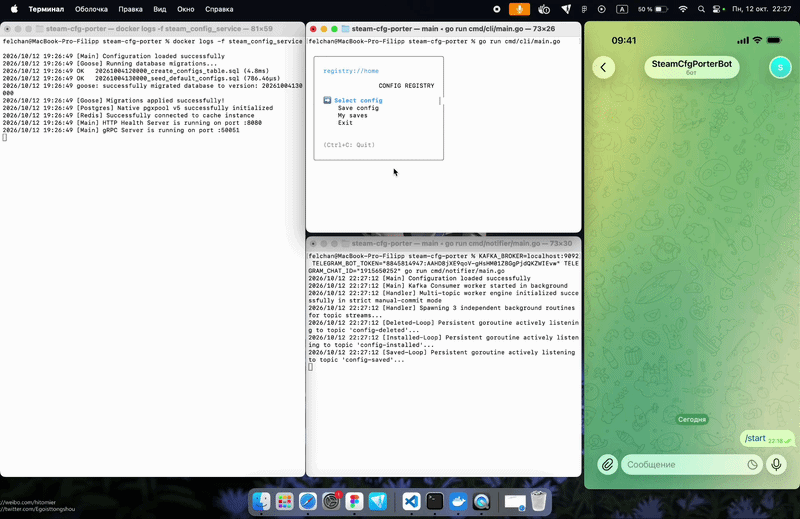
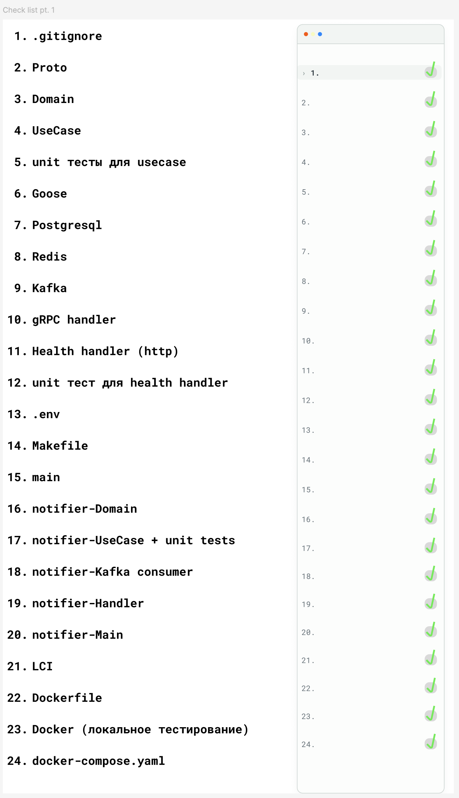
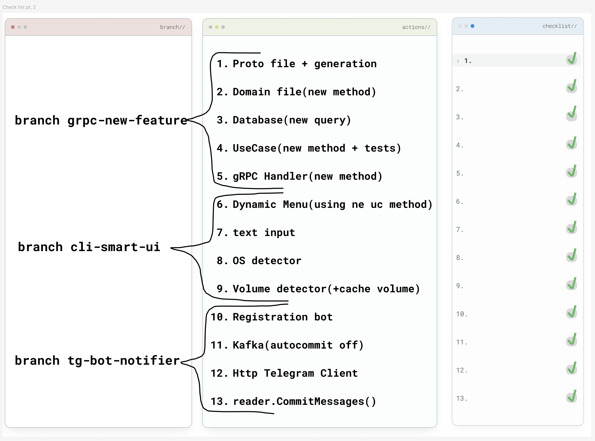
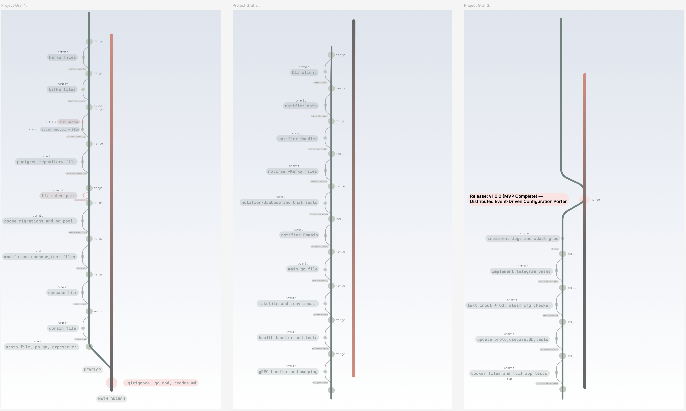
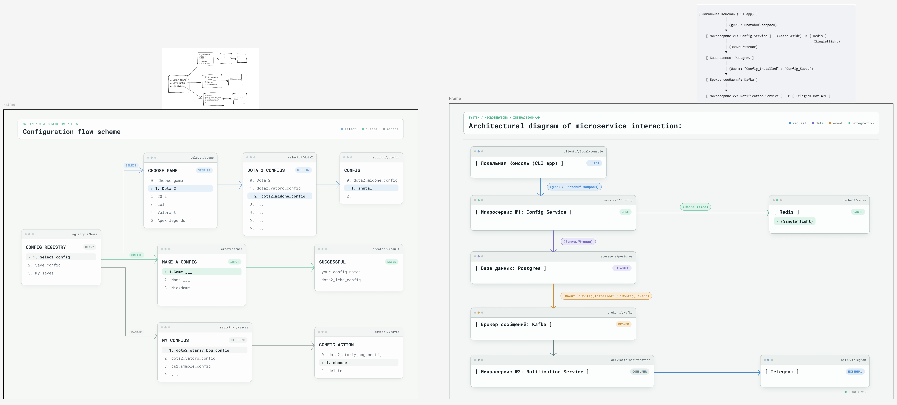
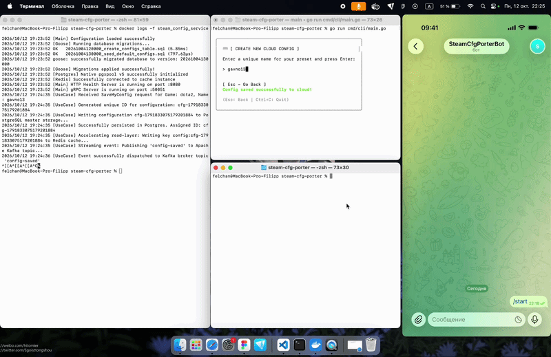

# Steam Config Porter 🎮☁️

A highly performant, event-driven distributed system designed to back up, synchronize, and port Source 2 engine gaming configurations (Dota 2, CS2) into cloud storage. Built with Go using Clean Architecture principles, gRPC protocols, and transactional message queue patterns.

## 🛠️ Technology Stack

- **Backend Core:** Go (Golang) inside Clean Architecture modules (`domain`, `usecase`, `infra`, `delivery`).
- **Transport Layer:** gRPC (Google Remote Procedure Calls) via Protocol Buffers (v3) schemas.
- **Message Broker:** Apache Kafka (`segmentio/kafka-go`) running transactional offset synchronization.
- **Database & Caching:** PostgreSQL (Master state) + Redis (In-memory acceleration keys).
- **High-Load Optimization:** `golang.org/x/sync/singleflight` execution structures to defeat Cache Stampede.
- **Interactive TUI CLI:** Custom CLI state-machine built over **Bubble Tea v2** with cross-platform OS path discovery (`runtime.GOOS`).
- **Infrastructure & Quality:** Automated Docker Compose multi-stage setups with healthchecks + boundary Unit Testing via `testify/assert`.

## 🏗️ Architecture Design

```text
[ TUI CLI (Bubble Tea v2) ]  ---( gRPC / Protobuf )--->  [ Config Service (Go) ]

                                                               |       |
                                                       (Postgres)   (Redis Cache)
                                                               |
                                                        (Apache Kafka)
                                                               |
                                                 [ Telegram Notifier Worker ]
                                                               |
                                                    (Telegram Bot Push API)
```

## ⚡ Key Architectural Patterns Implemented

1. **Guaranteed Delivery (Strict Manual Offsets):** The Notifier Service deactivates automatic Kafka commits. Message tracking offsets are explicitly acknowledged via `FetchMessage` and `CommitMessages` cycles only after remote Telegram API servers reply with a validated `200 OK` status, preventing data loss.
2. **Cache Stampede Prevention:** Leveraged `SingleFlight` concurrency bounds at the data delivery layer. Concurrent client fetches targeting identical configuration keys are bundled into a single atomic PostgreSQL query, protecting the core database from request spikes.
3. **Cache Penetration Protection:** Implemented defensive empty-key caching boundaries. When requested entities are completely missing from PostgreSQL (`ErrConfigNotFound`), the server injects short-lived (`5-minute`) placeholder markers into Redis, neutralizing high-concurrency database exhaustion attacks.
4. **Cross-Platform OS Discovery:** The terminal client automatically computes specific underlying platform environments (macOS, Windows, Linux) to map accurate default Steam layout directories dynamically.

---

## 🎬 End-to-End System Demonstration

### 🛠️ Scenario 1: Deploying Cluster Infrastructure
Demonstration of spinning up the Core PostgreSQL tables, memory acceleration layers, and the distributed transaction logging engine inside Docker sandbox environments.



### ⚡ Scenario 2: Cloud Saving & Event Streaming
Demonstration of the interactive TUI execution layer. Saving a profile natively formats schemas, saves the binary records into the master store, streams events via Kafka topics, and dispatches structured push alerts directly into the Telegram channel.



---

## 🗺️ Engineering & Development Process

Click on the sections below to explore the roadmap, repository git-history tree, and architecture drawings built during the design phase of this project.

<details>
<summary><b>📋 Phase 1 & 2 Development Checklists (Figma board)</b></summary>

Here are the detailed feature implementation checklists tracking usecases, gRPC handlers, and environment layers:




</details>

<details>
<summary><b>🧬 Git Commit History & Branching Strategy Diagram</b></summary>

Visual lineage of the actual `develop` to `main` code-merges, following strict Conventional Commits definitions:


</details>

<details>
<summary><b>🎨 UI/UX Frames & Component Flowcharts</b></summary>

Full state-machine interaction maps and service dependency definitions:


</details>

<details>
<summary><b>🛡️ Bonus: Kafka Fault Tolerance & Recovery</b></summary>

Demonstration of the system resiliency loop. When the notification delivery daemon is simulated as down, Kafka transparently stacks logs within the partition queues. Upon recovery, the worker fetches outstanding intervals, flushes notifications, and triggers atomic commit cycles seamlessly.


</details>

---

## 🚀 Local Deployment (Quick Start)

Follow these steps to launch the entire distributed architecture in local production-ready mode:

### Step 1: Spin up core Docker infrastructure
Run the database cluster, memory acceleration layers, and the message broker engine in the background:
```bash
docker compose up -d postgres redis kafka config-service
```

### Step 2: Establish Telegram connection and run the Notifier Daemon
Turn on your machine's system VPN connection (required to bypass regional Telegram API routing restrictions) and run the notification ingestion worker directly on the host Mac to capture Kafka event pipelines seamlessly:
```bash
KAFKA_BROKER=localhost:9092 TELEGRAM_BOT_TOKEN="your_bot_token" TELEGRAM_CHAT_ID="your_chat_id" go run cmd/notifier/main.go
```

### Step 3: Run the interactive TUI CLI client
Open a parallel native host terminal session and spin up the custom Bubble Tea application interface:
```bash
go run cmd/cli/main.go
```

---

## 🧪 Testing Boundary Execution

Run the global unified validation pipeline testing both `config_service` and `notifier_service` modules safely isolated from external live networks:

```bash
make test
```